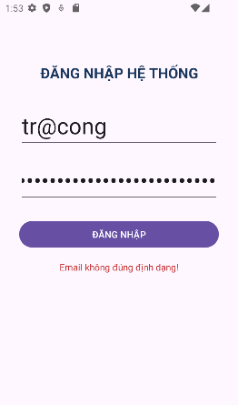
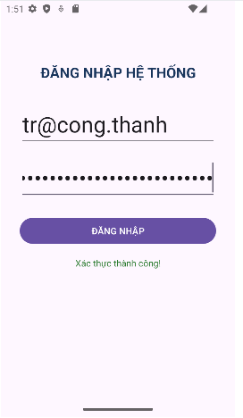

# KiemTra_LapTrinhUngDungDiDong_MSSV
repos bài lab tuần 07 môn Lập trình ứng dụng di động
# BÀI THI THỰC HÀNH - CÂU 1
- **Họ và tên:** [Điền họ và tên của bạn]
- **MSSV:** [Điền mã số sinh viên của bạn]
- **Tên dự án:** KiemTra_LapTrinhUngDungDiDong_MSSV

---

## Minh chứng Câu 1
### 1. Thông báo lỗi khi dữ liệu không hợp lệ

### 2. Xác thực thành công khi dữ liệu hợp lệ
